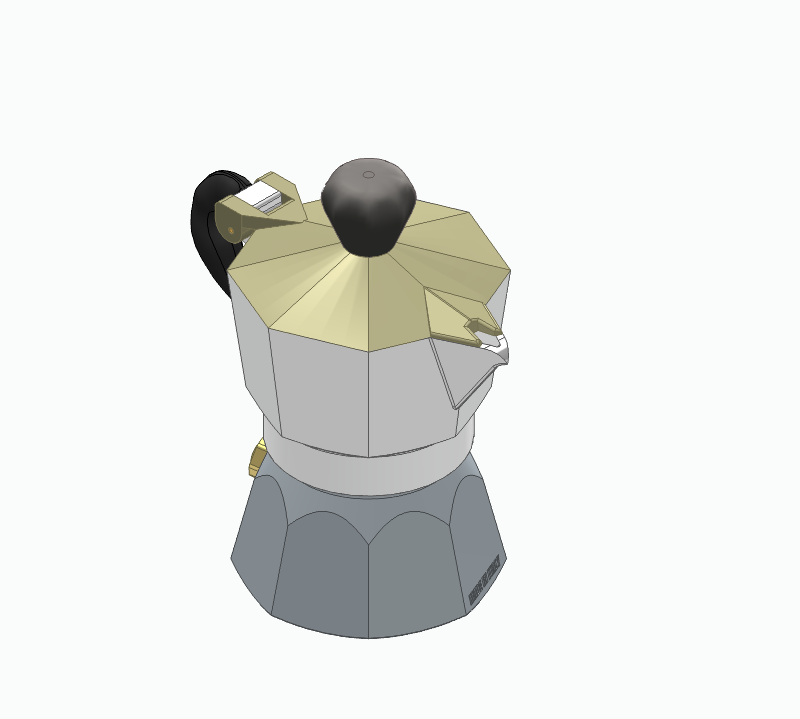
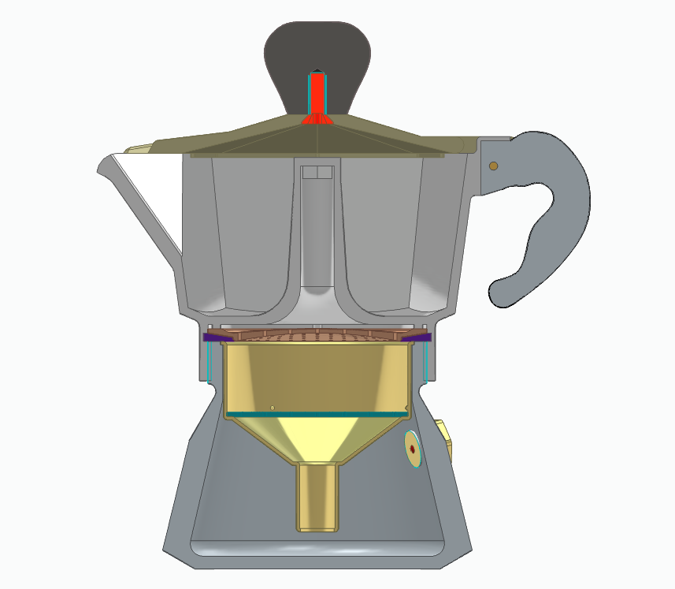
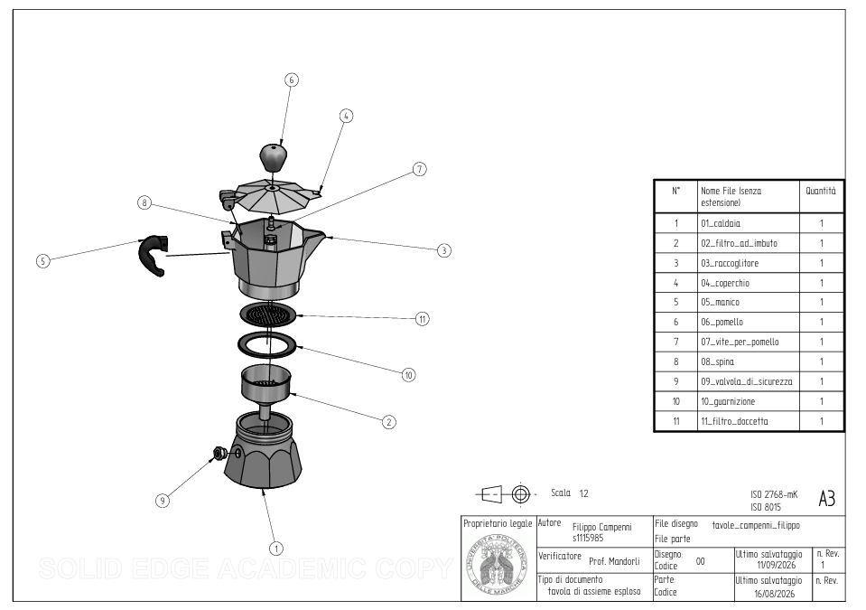

# Bialetti Moka Express (1-Cup) – 3D Parametric CAD & Technical Drafting

## Quick Access
📐 **[Assembly 2D Drawing & BOM (PDF)](./03_Technical_Drawings/assembly_moka_bialetti.pdf)**  
🔩 **[Boiler Manufacturing Drawing (PDF)](./03_Technical_Drawings/caldaia_moka_bialetti.pdf)**  
💥 **[Exploded View Drawing (PDF)](./03_Technical_Drawings/exploded_view_moka_bialetti.pdf)**  
🧊 **[Browse Universal 3D Geometry (.STEP Files)](./02_STEP_Files/)**

---

## Project Overview
Complete 3D parametric modelling, multi-part assembly design, and ISO-compliant 2D manufacturing drafting of the iconic **Bialetti Moka Express (1-cup model)**, developed using **Siemens Solid Edge** as part of the Computer-Aided Design (*Disegno Assistito dal Calcolatore*) coursework at **Università Politecnica delle Marche (UNIVPM)**.

## Engineering & Design Highlights
* **Feature-Based Parametric Modelling:** Modelled all **11 individual components** from scratch, applying robust geometric constraints and parametric relations.
* **Assembly Constraints & Interference Verification:** Assembled all components with axial, planar, and tangent mates, verifying mechanical clearances, thread engagements, and lid hinge kinematics.
* **Exploded Configuration:** Created custom assembly explosion configurations (`.cfg`) for clear visual inspection of the internal fluid path and component stack-up.
* **2D Manufacturing Drawings (ISO Standards):** Generated full technical drawings including longitudinal sectional views, assembly ballooning, Bill of Materials (BOM), dimensional tolerances, and surface roughness callouts.

## Visual Showcase

### Longitudinal Section View (Internal Fluid Path & Fit Check)

### Exploded Assembly View & Bill of Materials

## Bill of Materials (11 Components)
1. **Caldaia** *(Lower Boiler)*
2. **Filtro ad imbuto** *(Funnel Filter)*
3. **Raccoglitore superiore** *(Upper Collector)*
4. **Coperchio** *(Lid)*
5. **Manico** *(Handle)*
6. **Pomello** *(Lid Knob)*
7. **Vite per pomello** *(Knob Screw)*
8. **Spina** *(Hinge Pin)*
9. **Valvola di sicurezza** *(Safety Valve)*
10. **Guarnizione** *(Sealing Gasket)*
11. **Filtro doccetta** *(Filter Plate)*

## Repository Structure
* `01_Native_CAD_SolidEdge/`: Native Siemens Solid Edge files (11 `.par` parts, `.asm` assembly, `.cfg` exploded configuration, and `.dft` draft file).
* `02_STEP_Files/`: Neutral CAD geometry in `.step` (AP214) format for universal cross-platform compatibility (full assembly + individual components).
* `03_Technical_Drawings/`: Complete 2D engineering drawings and assembly BOM exported in `.pdf` format.
